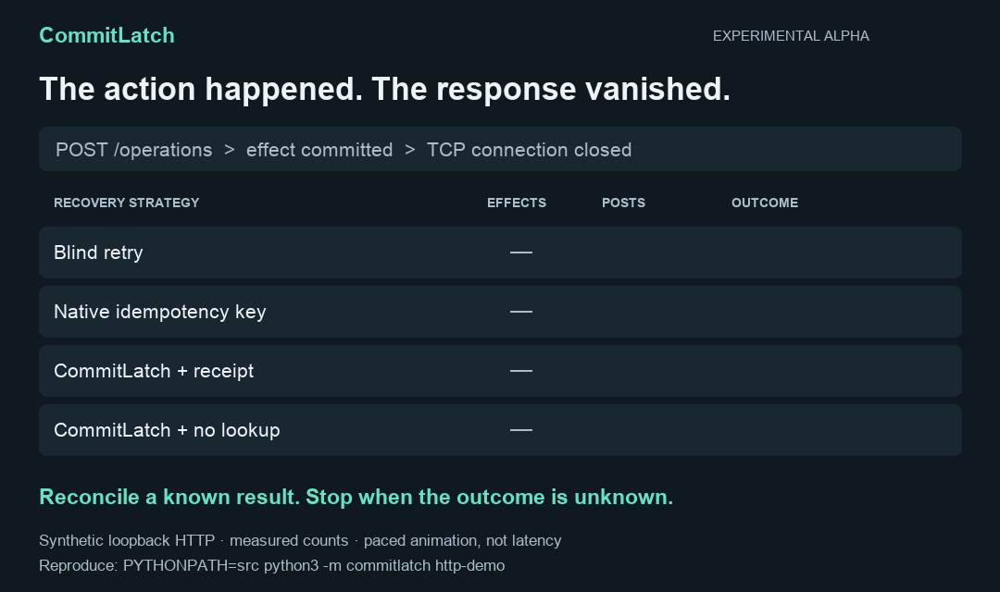

# CommitLatch

[](https://github.com/ArtAndrew/commitlatch/actions/workflows/tests.yml)

**Your agent lost the response. Should it repeat the action?**

CommitLatch records an external action before dispatch, recovers its result from
an authoritative receipt, and blocks another dispatch when the outcome is unknown.
A Python SDK with a SQLite ledger and no third-party runtime dependencies.



*Paced animation of measured synthetic HTTP results, not a screen recording or
latency benchmark. [Static image](assets/recovery-results.png) ·
[Raw evidence](assets/http-results.json) · [Methodology](docs/HTTP_DEMO.md).*

## Try the failure in under a minute

Python 3.9+, no API keys or Docker. After cloning, the demo only uses loopback HTTP.

```sh
git clone https://github.com/ArtAndrew/commitlatch.git
cd commitlatch
PYTHONPATH=src python3 -m commitlatch http-demo
```

A test provider commits an operation, then closes the TCP connection before
sending its response. The command asserts these outcomes:

| Recovery strategy | External effects | POST requests | Outcome |
| --- | ---: | ---: | --- |
| Blind retry | 2 | 2 | Duplicate |
| Same native idempotency key | 1 | 2 | Success |
| CommitLatch + matching receipt | 1 | 1 | Success |
| CommitLatch + unavailable lookup | 1 | 1 | UNKNOWN; repeat blocked |

**Native idempotency already works when its contract covers your operation. Keep
using it.** CommitLatch adds durable business identity, a shared local record and
an explicit recovery decision. [When do you need it?](docs/WHEN_TO_USE.md)

**Run the demo, then [tell us which provider you need next](https://github.com/ArtAndrew/commitlatch/discussions).**
A small reproducible failure report is more useful than a generic feature request.

## What is actually available

**Experimental alpha, 0.1.0a2.** SQLite, process-crash and loopback HTTP fixtures,
27 tests, an optional LangGraph node example, and CLI inspection/event playback.
PostgreSQL, Stripe, Temporal integration and managed hosting are roadmap items.
There is no universal exactly-once or production-readiness claim.

| Start here | What it demonstrates |
| --- | --- |
| [HTTP response-loss demo](docs/HTTP_DEMO.md) | Four strategies, including native provider idempotency |
| [LangGraph example](docs/LANGGRAPH.md) | Preserve one business key across repeated graph invocations; no LLM needed |
| [Recovery guarantees](docs/GUARANTEES.md) | State transitions, late workers and trust boundaries |
| [Adapter contract](docs/ADAPTERS.md) | What a provider must prove before a retry |
| [Validation](docs/VALIDATION.md) | Checks actually performed and their limits |
| [Roadmap](docs/ROADMAP.md) | Shipped work versus future work |

[Русское описание](README.ru.md) · [Contribute](CONTRIBUTING.md)

## Prefer a real process crash?

```sh
PYTHONPATH=src python3 -m commitlatch demo --directory demo-output
```

This separate fixture terminates a real child process with `os._exit(42)` after
the test service commits an effect to its own database. Open `demo-output/report.html`
for an offline report. Use a new or empty output directory. This command needs no
listening socket. Neither fixture is a benchmark against Temporal, Restate or DBOS.

## Use the library

```python
from commitlatch import CommitLatch, SQLiteLedger, UnknownOutcome

engine = CommitLatch(SQLiteLedger("actions.db"))
# adapter is your implementation of execute() and reconcile().
try:
    result = engine.run(
        namespace="shop-account-1",
        key="order-42/refund-request-1",
        adapter=adapter,
        arguments={"operation": "refund", "amount_minor": 1200},
    )
except UnknownOutcome:
    action = engine.reconcile("shop-account-1", "order-42/refund-request-1", adapter)
    # action["state"] can still be UNKNOWN. Do not treat it as success.
```

For a complete executable example with the test adapter:

```sh
PYTHONPATH=src python3 examples/quickstart.py
```

Use the same namespace, business key, arguments and adapter identity on every
retry of one authorized operation. A separate legitimate operation needs a new
business key. The model must not invent replacement keys to evade this boundary.

When an operation has succeeded, repeating `run()` returns its recorded result
without calling the adapter. Changing the payload or adapter for an existing key
raises `ActionConflict`. When the outcome is unknown, `run()` blocks; only
`reconcile()` performs a lookup. It never automatically calls `execute()`.

Only an adapter-certified non-execution can become `FAILED` and be explicitly
reset using `retry_failed()`. Timeouts and missing search results are not such
proof. This conservative alpha intentionally sacrifices automatic progress
when the provider cannot establish the outcome.

## Inspect and replay

```sh
PYTHONPATH=src python3 -m commitlatch inspect --db demo-output/reconciled/ledger.db
PYTHONPATH=src python3 -m commitlatch replay --db demo-output/reconciled/ledger.db
PYTHONPATH=src python3 -m commitlatch reconcile-demo \
  --db demo-output/opaque/ledger.db \
  --provider-db demo-output/opaque/provider.db --opaque
```

`replay` is read-only event playback. It does not replay arbitrary Python code,
resume an agent, invoke a model or call an external service. `reconcile-demo` is
only for the bundled test adapter, and exits with code 2 if the outcome remains
unknown. Adapter exceptions also fail closed to `UNKNOWN`.

## Install locally

To install the CLI into an isolated environment from this checkout:

```sh
python3 -m venv .venv
.venv/bin/python -m pip install .
.venv/bin/commitlatch demo
```

Installation may fetch build tools; the library itself has zero third-party
runtime dependencies. This alpha is installed from source; there is no published
PyPI release.

## Test

```sh
PYTHONPATH=src python3 -m unittest discover -s tests -v
```

The suite exercises actual subprocess crashes, independent process contention,
late-worker fencing, payload conflicts, uncertain results, explicit safe retry,
read-only playback and unsafe receipt handling. GitHub Actions runs the suite and
installation checks on Linux/macOS with Python 3.9/3.11/3.13, plus a separate
LangGraph example on Python 3.12. See the linked
[workflow runs](https://github.com/ArtAndrew/commitlatch/actions/workflows/tests.yml)
for their current status.

## Scope and trust boundary

- SQLite is for one host with local storage, not a distributed/NFS ledger.
- All competing callers for one business operation must share its ledger/key.
- Local leases fence database updates, not already-dispatched external requests.
- Direct calls outside this library, new business keys, deleted ledgers and
  restored stale backups can bypass its protection.
- A successful receipt proves what the adapter verifies. It does not prove
  the action was authorized or appropriate, or that its outcome is irreversible.
- Arguments and results are stored in plaintext. Do not pass credentials or
  sensitive production data into this alpha. Namespace separation is naming,
  not an authentication or tenant-security mechanism.
- The test service uses a separate SQLite transaction to model the commit gap.
  The HTTP fixture adds real loopback sockets; production provider semantics remain untested.

## Contribute

Start with a reproducible failure case and a test. Adapter contributions must
document identity scope, receipt semantics, lookup consistency, in-flight
requests and any idempotency retention window. Do not add blind automatic retry.
See [CONTRIBUTING.md](CONTRIBUTING.md).

## License

Apache-2.0. See [LICENSE](LICENSE).
