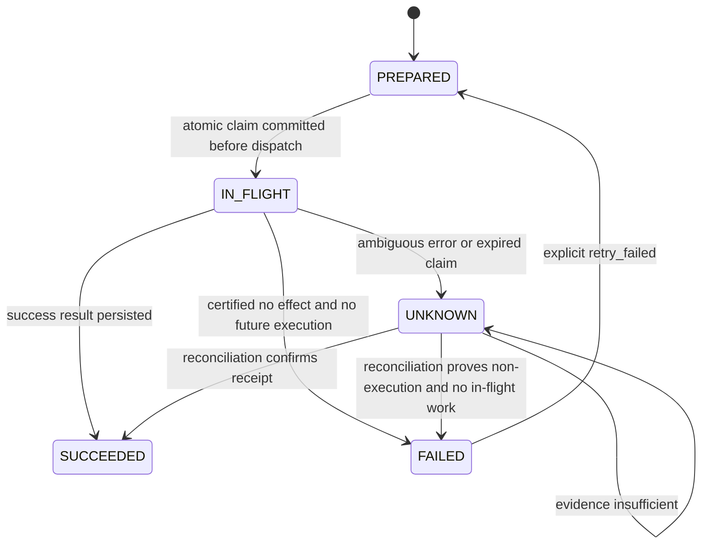

# Recovery semantics and limits

## State machine

`FAILED` has a narrower meaning than in most job queues: a trusted adapter
certified that the operation was NOT applied and cannot apply later. An HTTP
500, timeout, invalid response, missing search result, or exhausted retry budget
must not be converted to FAILED without that proof.

No transition from UNKNOWN directly dispatches another attempt. Even if a
provider supports an idempotency key, this alpha does not automatically retry an
ambiguous operation. Provider-specific safe redispatch can be added only with a
documented retention/delivery contract and corresponding fault tests.

## Identity

`(namespace, business_key)` is unique. Its adapter identity and strict-JSON
argument fingerprint are immutable. A generated `cl_...` identifier is the stable
external correlation key for that ledger action. Reusing the same business key
in another ledger does not preserve this external key.

The application, not an LLM, must select and persist the business key for one
authorized business event. A new key denotes a new operation. This library does
not infer semantic equivalence, enforce user authority, or deduplicate across
independent ledger databases.

## Claims, crashes and late workers

Registration, claims, state changes and their events use SQLite transactions.
The external effect intentionally occurs outside the ledger transaction.

An active claim blocks concurrent execution/reconciliation. On expiry, a caller
marks the action UNKNOWN and invalidates the old token. A late worker cannot
overwrite the newer local state. Expiry alone does not interrupt that worker or
cancel its request at the provider; it may still cause an external effect.

Therefore, an empty lookup while an old request might still execute is UNKNOWN,
not permission to dispatch again. This is covered by the late-worker test.

The default lease is 30 seconds, without heartbeat renewal in this alpha. Use a
lease suitable for the bounded adapter operation. Lease expiry is evaluated
when a caller accesses the action; there is no background sweeper. Wall-clock
jumps may affect liveness, and local fencing does not resolve external races.

Successful receipt reconciliation returns the recorded action outcome; it is
not a guarantee that current business state is unchanged or irreversible.

## Storage and deployment

The backend uses SQLite WAL and synchronous FULL. Tests cover process crashes,
not hardware power loss, disk corruption, filesystem behavior, or backup restore.
Use local storage on one host. This is not a replicated or distributed database.

Deleting or restoring stale records can permit new execution. No retention or
deletion policy is implemented. The database contains raw arguments/results and
receipt evidence; it has no encryption, access-control service or secret vault.

Events are appended by the application, but they are not cryptographically
immutable or protected against a database administrator. No compliance
certification follows from this journal.

## Replay

CLI replay opens the ledger in SQLite read-only mode and prints events. It does
not call adapters or models. Workflow replay, environment rollback, model replay,
compensation and agent checkpointing are outside this version's scope.
