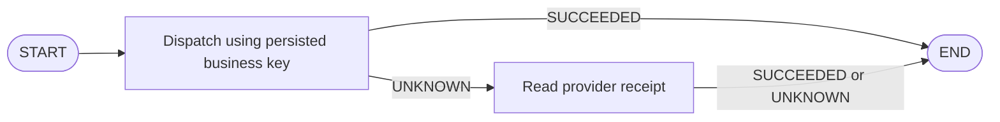

# A LangGraph node that does not blindly repeat an external action

This executable example uses LangGraph **1.2.16** and Python **3.12**. It has no
model calls, API keys or paid services. LangGraph is an optional example dependency,
not a dependency of CommitLatch itself.

```sh
python3.12 -m venv .venv
.venv/bin/python -m pip install . -r examples/requirements-langgraph.txt
LANGSMITH_TRACING=false .venv/bin/python examples/langgraph_recovery.py
LANGSMITH_TRACING=false .venv/bin/python examples/langgraph_recovery.py --opaque
```

Dependency installation needs network access. Running the example needs only a
temporary loopback HTTP listener.



The provider commits the operation and drops its HTTP response. The dispatch
node catches `UnknownOutcome` and routes to read-only reconciliation. No edge
routes UNKNOWN back to a mutating call. Other errors are allowed to surface.

The example then constructs a new graph and a new CommitLatch engine using the
same ledger and business key, and invokes it again:

- With receipt lookup: both invocations return SUCCEEDED and the same result.
- With `--opaque`: both return UNKNOWN, so the application must stop or escalate.
- In both cases: exactly one POST and one effect in this particular fixture.

Assertions check these observations. Read the full implementation in
[`examples/langgraph_recovery.py`](../examples/langgraph_recovery.py).

## This complements graph persistence

There is no graph checkpointer or LLM in this example. It demonstrates a tool
boundary and durable business identity across graph reconstruction, not recovery
of a complete agent's conversation or an integration with LangGraph Agent Server.
Production graph checkpointing remains your responsibility.

Choose the key in application code from one authorized business event. Preserve
it across retries and graph invocations. An LLM-generated replacement key can
bypass the boundary; this library cannot prevent that outside its API.

Official references used for the example:

- [LangGraph Graph API quickstart](https://docs.langchain.com/oss/python/langgraph/quickstart)
- [LangGraph persistence](https://docs.langchain.com/oss/python/langgraph/persistence)
